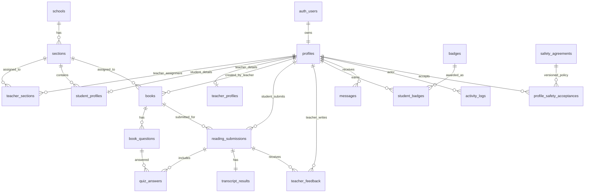

# ReadBloom Backend Integration Roadmap

Last updated: 2026-07-19
Current progress: Phase 1 repository cleanup has its first implementation pass completed in all three apps. Phase 2 backend foundation source files have been added locally under `supabase/` and were applied manually in Supabase by the project owner. Phase 3 Supabase Auth integration has started in the Flutter apps. Phase 4 profile, sections, safety agreement, and profile picture integration is complete based on project-owner live testing. Phase 5 books and quiz management is complete for the current create-and-display scope based on project-owner live testing. Phase 6 student recording flow and Supabase video upload is complete based on project-owner live testing. Phase 7 speech-to-text processing is complete for the current backend scope based on project-owner live testing; transcripts now appear in Supabase after student uploads. Phase 8 quiz turn-in persistence is complete based on project-owner live testing. Phase 9 teacher student-progress and review is in progress: the first implementation pass is in place, teacher login/data loading was fixed, and project-owner live testing now shows correct teacher data, but Phase 9 is not complete because some data-reflection issues still need to be resolved. Phase 10 badges, journey, messages, and activity logs now has a local implementation pass across the student, teacher, and admin apps; it passes analyzer/tests and needs live Supabase validation. Phase 11 admin account and data management now has a local implementation pass; it adds `admin-create-user` and `admin-delete-user` Edge Function sources, section-backed admin account creation, role/status/section filters, account disabling/deletion, section creation/deletion, book deletion, reading-history deletion, and audit logging. Phase 12 QA/security/production hardening is in progress with blocking loading dialogs, production-facing dummy-data cleanup, forgot-password recovery routing, focused password-reset provider tests, and a manual QA checklist now in place.

## Goal

Build the three ReadBloom Flutter applications into one synced platform backed by a single Supabase project:

- Students read assigned passages, record video/audio, submit quizzes, receive feedback, and track journey/achievements.
- Teachers manage books and quizzes, review student reading submissions, watch videos, inspect transcripts/differences, send feedback, update skill levels, and assign badges.
- Admins manage accounts and monitor student/teacher activity.

Supabase will be the single source of truth for authentication, profiles, books, quizzes, submissions, transcript results, feedback, badges, sections, and activity logs.

## Architecture Principles

1. One Supabase project for all three apps.
2. One Auth user per real account.
3. One `profiles` row per Auth user.
4. Strict role isolation: `student`, `teacher`, and `admin` accounts can only access their allowed app and data.
5. Flutter mobile and web screens share the same backend providers/repositories/services.
6. No service-role key in Flutter apps.
7. Supabase Storage buckets are private by default.
8. Speech-to-text runs server-side through Supabase Edge Functions.
9. Dummy data is removed or moved into seed scripts only.
10. Every important user action writes an activity/audit row.

## Recommended Backend Components

### Supabase

- Supabase Auth for login, session persistence, password reset, and account identities.
- Supabase Postgres for relational data.
- Supabase Storage for profile pictures, reading videos, and extracted audio files.
- Supabase Row Level Security for all user-facing tables.
- Supabase Edge Functions for privileged account creation, transcription jobs, signed URL generation, and other server-only logic.

### Speech-to-Text

Recommended first implementation:

- Upload the student's recorded video/audio to Supabase Storage.
- Create a `reading_submissions` row with status `uploaded`.
- Call a Supabase Edge Function, for example `process-reading-submission`.
- Edge Function downloads or reads the video/audio source, sends it to Google AI Studio through the Gemini API for transcription, stores the transcript, runs text alignment, and marks the submission `processed`.

Google AI Studio should be used for the speech-to-text functionality through the Gemini API. Recommended first implementation: use the stable Gemini Flash model `gemini-3.5-flash`, with a prompt that asks for a clean verbatim transcript of the student's reading. Gemini supports audio understanding and can generate transcripts from uploaded audio; Gemini video understanding can also process video files such as `video/webm` and `video/mp4`. For reliability and lower token/cost usage, the preferred production path is to extract or store an audio file when possible, then send audio to Gemini. If audio extraction is not available in the first pass, send the uploaded reading video directly to Gemini as video input.

Do not call Google AI Studio or the Gemini API directly from Flutter. Keep the Gemini API key only in Supabase Edge Function secrets, for example as `GEMINI_API_KEY`.

Google's Gemini audio documentation notes that Gemini is suitable for completed audio transcription, but not real-time transcription. That matches ReadBloom's current flow because students upload a completed reading recording before transcription starts.

### Text Comparison

There is no single magic API that should own the exact ReadBloom grading logic. Use speech-to-text for transcription, then implement deterministic alignment:

1. Store the original passage text.
2. Normalize expected text and transcript:
   - lowercase for comparison,
   - remove or standardize punctuation,
   - collapse whitespace,
   - optionally keep original token positions for display.
3. Tokenize into words.
4. Align expected tokens and spoken tokens using edit distance or sequence alignment.
5. Classify tokens:
   - `match`
   - `missing` or omitted expected word
   - `extra` spoken word
   - `substituted` word
6. Store the alignment result as JSON.
7. Render highlights in teacher review and optionally student results later.

For now, omission, repetition, self-correction, and mispronunciation can be manually tagged by the teacher from the transcript in the review popup. Automatic detection for these categories should be added later after transcript alignment is stable.

## Proposed ERD

`auth_users` represents Supabase `auth.users`. It is not created manually in `public`; public tables reference `auth.users(id)`.

## Proposed Tables

### `profiles`

Purpose: shared account information for all apps.

Columns:

- `id uuid primary key references auth.users(id) on delete cascade`
- `role text not null check (role in ('student', 'teacher', 'admin'))`
- `email text not null unique`
- `full_name text not null`
- `avatar_url text`
- `status text not null default 'active' check (status in ('active', 'disabled'))`
- `created_at timestamptz not null default now()`
- `updated_at timestamptz not null default now()`

Notes:

- Every app checks this row after login.
- Wrong role should immediately sign out and show "This account is not allowed on this platform."
- RLS must prevent students from reading all profiles.

### `student_profiles`

Purpose: student-specific profile data.

Columns:

- `profile_id uuid primary key references profiles(id) on delete cascade`
- `student_number text unique`
- `grade_level text not null`
- `section_id uuid references sections(id)`
- `current_skill_level text default 'Reading Explorer'`
- `reading_level int not null default 1`
- `vocabulary_level int not null default 1`
- `word_master_level int not null default 1`
- `comprehension_level int not null default 1`
- `days_streak int not null default 0`
- `last_login_date date`
- `created_at timestamptz not null default now()`
- `updated_at timestamptz not null default now()`

### `teacher_profiles`

Purpose: teacher-specific profile data.

Columns:

- `profile_id uuid primary key references profiles(id) on delete cascade`
- `employee_number text unique`
- `school_id uuid references schools(id)`
- `created_at timestamptz not null default now()`
- `updated_at timestamptz not null default now()`

### `schools`

Columns:

- `id uuid primary key default gen_random_uuid()`
- `name text not null`
- `created_at timestamptz not null default now()`

### `sections`

Columns:

- `id uuid primary key default gen_random_uuid()`
- `school_id uuid references schools(id)`
- `grade_level text not null`
- `name text not null`
- `created_at timestamptz not null default now()`
- `unique (school_id, grade_level, name)`

### `teacher_sections`

Purpose: which teachers can manage which grade/section.

Columns:

- `teacher_id uuid references profiles(id) on delete cascade`
- `section_id uuid references sections(id) on delete cascade`
- `created_at timestamptz not null default now()`
- `primary key (teacher_id, section_id)`

### `safety_agreements`

Purpose: versioned safety/privacy agreement text.

Columns:

- `id uuid primary key default gen_random_uuid()`
- `version text not null unique`
- `title text not null`
- `body text not null`
- `is_active boolean not null default false`
- `created_at timestamptz not null default now()`

### `profile_safety_acceptances`

Purpose: record that the student accepted the safety agreement once.

Columns:

- `profile_id uuid references profiles(id) on delete cascade`
- `agreement_id uuid references safety_agreements(id)`
- `accepted_at timestamptz not null default now()`
- `accepted_from text`
- `primary key (profile_id, agreement_id)`

Behavior:

- On student login, fetch the active agreement.
- If no acceptance exists for that active agreement, show the safety agreement.
- If accepted, do not show it again until a new active agreement version is published.

### `books`

Purpose: teacher-created reading passages.

Columns:

- `id uuid primary key default gen_random_uuid()`
- `created_by uuid references profiles(id)`
- `section_id uuid references sections(id)`
- `grade_level text not null`
- `title text not null`
- `passage_text text not null`
- `status text not null default 'published' check (status in ('draft', 'published', 'archived'))`
- `created_at timestamptz not null default now()`
- `updated_at timestamptz not null default now()`

Notes:

- Students only see published books assigned to their section/grade.
- Teachers see books they created or books in their assigned sections, depending on final permission rules.

### `book_questions`

Purpose: quizzes related to a book.

Columns:

- `id uuid primary key default gen_random_uuid()`
- `book_id uuid references books(id) on delete cascade`
- `question_text text not null`
- `options jsonb not null`
- `correct_option_index int not null`
- `sort_order int not null default 0`
- `created_at timestamptz not null default now()`

Validation:

- `options` should be a JSON array of strings.
- `correct_option_index` must be inside the options range. This may need a trigger or Edge Function validation.

### `reading_submissions`

Purpose: one student reading attempt.

Columns:

- `id uuid primary key default gen_random_uuid()`
- `student_id uuid references profiles(id)`
- `book_id uuid references books(id)`
- `book_title_snapshot text not null`
- `passage_text_snapshot text not null`
- `video_path text`
- `audio_path text`
- `duration_seconds int`
- `time_limit_seconds int not null default 300`
- `is_overtime boolean not null default false`
- `status text not null default 'draft' check (status in ('draft', 'uploading', 'uploaded', 'processing', 'processed', 'submitted', 'failed'))`
- `submitted_at timestamptz`
- `created_at timestamptz not null default now()`
- `updated_at timestamptz not null default now()`

Notes:

- Store passage snapshot so later edits to the book do not rewrite old submissions.
- Recording should continue past 5 minutes, but set `is_overtime = true` once `duration_seconds > 300`.

### `transcript_results`

Purpose: transcription and text comparison result for a submission.

Columns:

- `id uuid primary key default gen_random_uuid()`
- `submission_id uuid unique references reading_submissions(id) on delete cascade`
- `raw_transcript text`
- `normalized_transcript text`
- `normalized_expected_text text`
- `alignment_json jsonb`
- `match_count int default 0`
- `missing_count int default 0`
- `extra_count int default 0`
- `substitution_count int default 0`
- `overall_accuracy numeric`
- `processing_provider text`
- `processing_model text`
- `processing_error text`
- `created_at timestamptz not null default now()`
- `updated_at timestamptz not null default now()`

### `quiz_answers`

Purpose: student answers for a reading submission.

Columns:

- `id uuid primary key default gen_random_uuid()`
- `submission_id uuid references reading_submissions(id) on delete cascade`
- `question_id uuid references book_questions(id)`
- `selected_option_index int not null`
- `is_correct boolean not null`
- `answered_at timestamptz not null default now()`

### `teacher_feedback`

Purpose: teacher report/feedback visible in student messages.

Columns:

- `id uuid primary key default gen_random_uuid()`
- `submission_id uuid references reading_submissions(id) on delete cascade`
- `teacher_id uuid references profiles(id)`
- `student_id uuid references profiles(id)`
- `feedback_text text not null`
- `created_at timestamptz not null default now()`

### `messages`

Purpose: student message center.

Columns:

- `id uuid primary key default gen_random_uuid()`
- `recipient_id uuid references profiles(id)`
- `sender_id uuid references profiles(id)`
- `type text not null check (type in ('teacher_feedback', 'system'))`
- `title text not null`
- `body text not null`
- `related_submission_id uuid references reading_submissions(id)`
- `read_at timestamptz`
- `created_at timestamptz not null default now()`

### `badges`

Purpose: teacher/admin-defined badge catalog.

Columns:

- `id uuid primary key default gen_random_uuid()`
- `name text not null unique`
- `description text`
- `icon_url text`
- `created_by uuid references profiles(id)`
- `created_at timestamptz not null default now()`

### `student_badges`

Purpose: badges awarded to students.

Columns:

- `student_id uuid references profiles(id) on delete cascade`
- `badge_id uuid references badges(id) on delete cascade`
- `awarded_by uuid references profiles(id)`
- `awarded_at timestamptz not null default now()`
- `primary key (student_id, badge_id)`

### `activity_logs`

Purpose: admin and teacher-visible activity feed.

Columns:

- `id uuid primary key default gen_random_uuid()`
- `actor_id uuid references profiles(id)`
- `actor_role text`
- `action text not null`
- `entity_type text`
- `entity_id uuid`
- `metadata jsonb`
- `created_at timestamptz not null default now()`

Examples:

- `student.logged_in`
- `student.started_reading`
- `student.submitted_reading`
- `teacher.created_book`
- `teacher.sent_feedback`
- `admin.created_account`

## Storage Buckets

### `avatars`

- Stores profile pictures.
- Can be public if acceptable, but private with signed URLs is safer.
- Path pattern: `avatars/{profile_id}/{timestamp_or_uuid}.jpg`

### `reading-videos`

- Private bucket.
- Stores student reading video.
- Path pattern: `reading-videos/{student_id}/{submission_id}/reading.webm`

### `reading-audio`

- Private bucket.
- Stores extracted audio if needed separately from video.
- Path pattern: `reading-audio/{student_id}/{submission_id}/reading.m4a`

Storage notes:

- Use standard upload for small files.
- Use resumable upload if recordings are frequently larger than 6 MB.
- Flutter web may need binary upload (`uploadBinary`) while mobile can upload files directly.
- Teachers should access private videos through signed URLs generated only after authorization checks.

## RLS and Role Isolation Plan

### Required App Login Checks

After Supabase Auth login:

1. Fetch `profiles` row for `auth.uid()`.
2. Check `status = 'active'`.
3. Check role matches current app:
   - student app requires `role = 'student'`
   - teacher app requires `role = 'teacher'`
   - admin app requires `role = 'admin'`
4. If role mismatch, sign out and show an access-denied message.

This client check is for UX only. Database policies must still enforce role boundaries.

### RLS Policy Direction

Students can:

- Select their own profile and student profile.
- Update limited own profile fields, such as avatar.
- Select published books assigned to their section.
- Insert and select their own reading submissions.
- Insert and select their own quiz answers.
- Select their own messages and badges.
- Insert their own safety agreement acceptance.

Teachers can:

- Select own profile.
- Select sections assigned to them.
- Select students in assigned sections.
- Create/update books and questions for assigned sections.
- Select submissions from students in assigned sections.
- Select transcript results for those submissions.
- Insert teacher feedback for students in assigned sections.
- Create badges if allowed by project policy.
- Award badges to students in assigned sections.

Admins can:

- Select users/profiles.
- Create users through Edge Function.
- Disable users through Edge Function.
- View activity logs and dashboard counts.
- Manage sections and safety agreement versions if needed.

## Edge Functions

### `admin-create-user`

Purpose:

- Create Supabase Auth user.
- Create `profiles` row.
- Create `student_profiles` or `teacher_profiles` row.
- Assign section if student.
- Assign teacher sections if teacher.
- Write activity log.

Security:

- Callable only by authenticated admins.
- Uses service role key server-side.
- Validates email uniqueness and role.

### `process-reading-submission`

Purpose:

- Validate caller owns the submission or is system-triggered.
- Mark submission `processing`.
- Retrieve video/audio from Storage.
- Transcribe the submitted audio/video with Google AI Studio through the Gemini API.
- Normalize and align transcript against `passage_text_snapshot`.
- Insert/update `transcript_results`.
- Mark submission `processed` or `failed`.
- Write activity log.

### `create-signed-video-url`

Purpose:

- Validate teacher/admin is allowed to review the submission.
- Return temporary signed URL for video playback.

### `send-teacher-feedback`

Purpose:

- Validate teacher has access to student/submission.
- Insert `teacher_feedback`.
- Insert student `messages` row.
- Write activity log.

## Phase-by-Phase Implementation

## Phase 1: Repository Cleanup and Backend Readiness

Goal: prepare the three Flutter apps for real Supabase data without changing every screen at once.

Tasks:

1. Add project-level documentation:
   - Keep `CURRENT_STATUS.md`.
   - Keep this `ROADMAP.md`.
   - Replace default app READMEs later with setup notes.
   - Status: root docs exist and have been updated after the first Phase 1 implementation pass. App READMEs still need project-specific setup notes.
2. Remove direct dummy-data dependency from widgets:
   - Keep dummy data only inside temporary repository/mock classes.
   - Do not let UI screens instantiate hardcoded business data.
   - Status: partially complete. Main provider-owned dummy business data was moved to mock repositories. Some static display placeholders still remain in screens and should be cleaned while connecting real features.
3. Introduce app layers in each repo:
   - `lib/config`
   - `lib/services`
   - `lib/repositories`
   - `lib/models`
   - `lib/providers`
   - Status: `lib/config`, `lib/services`, and `lib/repositories` now exist in all three apps.
4. Add shared backend contracts inside each app:
   - `AuthService`
   - `ProfileRepository`
   - `BookRepository`
   - `SubmissionRepository`
   - `StorageService`
   - `ActivityLogRepository`
   - Status: partially complete. `AuthService` exists in all three apps. Initial app-specific repositories exist as `StudentRepository`, `TeacherRepository`, and `AdminRepository`. More granular repositories should be added as Supabase schema work begins.
5. Add loading/error/empty states to screens that currently assume data always exists.
   - Status: not complete. This remains important before replacing sync mocks with async Supabase calls.
6. Fix known behavioral bugs before backend work:
   - Student quiz must not complete empty-question books.
   - Student quiz must guard against out-of-range question index.
   - Student book labels should use book fields, not title string parsing.
   - Admin users screen should dispose `_searchController`.
   - Status: complete in first Phase 1 pass.
7. Standardize model names across apps:
   - `Profile`
   - `StudentProfile`
   - `TeacherProfile`
   - `Section`
   - `Book`
   - `BookQuestion`
   - `ReadingSubmission`
   - `TranscriptResult`
   - `TeacherFeedback`
   - `Badge`
   - `ActivityLog`
   - Status: not complete. Existing model names remain mostly unchanged to avoid broad UI churn before Supabase schema migration.
8. Add environment placeholders:
   - Supabase URL.
   - Supabase publishable key.
   - Redirect URLs for password reset.
   - Status: partially complete. `BackendConfig` with Supabase URL and publishable key placeholders exists in all three apps. Redirect URLs still need to be added when Supabase auth is implemented.
9. Keep all UI mobile/web folders, but route both variants through the same providers.
   - Status: complete. Mobile and web screens still share each app's provider.
10. Expand tests:
   - Provider tests for login state.
   - Quiz state tests.
   - Role mismatch tests using mocked auth service.
   - Status: partially complete. Provider tests were added for student quiz safety, teacher book/badge behavior, and admin create/delete behavior. Login and role mismatch tests remain for the Supabase auth phase.

Exit criteria:

- Apps still run with mock repositories.
- No widget directly depends on seeded dummy data. Current status: partially complete; dummy business data moved to mock repositories, but static placeholders still remain in screens.
- Mobile and web screens use the same provider APIs. Current status: complete.
- `flutter analyze` and `flutter test` pass in all three apps. Current status: complete after first Phase 1 pass.

## Phase 2: Supabase Project, Schema, Storage, and Seed Data

Goal: create the actual backend foundation.

Tasks:

1. Create one Supabase project.
   - Status: complete outside this workspace. The project owner applied the migrations in Supabase.
2. Create SQL migrations for all tables listed in this roadmap.
   - Status: complete locally in `supabase/migrations/202607170001_initial_schema.sql`.
3. Enable RLS on all public tables.
   - Status: complete locally in `supabase/migrations/202607170002_rls_policies.sql`.
4. Create private Storage buckets:
   - `avatars`
   - `reading-videos`
   - `reading-audio`
   - Status: complete locally in `supabase/migrations/202607170003_storage.sql`.
5. Create seed data:
   - one admin,
   - one teacher,
   - several sections,
   - several students,
   - sample books,
   - sample quizzes,
   - sample badges.
   - Status: complete locally in `supabase/seed.sql`.
6. Create database triggers:
   - `updated_at` maintenance.
   - optional activity log inserts for important table changes.
   - Status: partially complete. `updated_at` triggers exist for mutable core tables. Automatic activity-log triggers are not added yet because activity logging should be finalized with Edge Function workflows.
7. Create validation functions where needed:
   - question option validation,
   - role checks,
   - teacher-section checks.
   - Status: partially complete. Role and teacher-section helper functions exist. Question option JSON shape is constrained, but full `correct_option_index < options.length` validation still needs a trigger or Edge Function validation.
8. Configure Auth redirect URLs:
   - student web reset URL,
   - teacher web reset URL,
   - admin web reset URL,
   - mobile deep links if mobile builds are required.
   - Status: not complete. This requires a real Supabase project and final app URLs/deep links.

Exit criteria:

- Schema can be recreated from migrations.
- RLS is enabled.
- Seed users can log in.
- Storage buckets exist and deny unauthorized access.

Current Phase 2 validation status:

- Backend source files are present locally.
- SQL was statically reviewed, but not executed locally because `supabase` and `psql` are not installed.
- Seeded Auth users are intended for local development only; hosted projects should create users through the planned admin flow or Supabase dashboard.
- Project owner reports that migrations 1, 2, and 3 have been applied in the Supabase console.

## Phase 3: Supabase Auth and Role-Specific Login

Goal: replace mock login in all three apps.

Tasks:

1. Add `supabase_flutter` to each app.
   - Status: complete.
2. Initialize Supabase in each `main.dart`.
   - Status: complete. Initialization is skipped safely if `BackendConfig` has no URL/key.
3. Implement `AuthService`:
   - sign in with email/password,
   - sign out,
   - current session,
   - auth state listener,
   - reset password email,
   - update password after reset.
   - Status: partially complete. Sign in, sign out, current session restore, reset password email, and update password service methods exist. A full auth-state listener and reset-password screen/deep-link UI are still pending.
4. Implement role check after login:
   - student app accepts only student accounts,
   - teacher app accepts only teacher accounts,
   - admin app accepts only admin accounts.
   - Status: complete at service level. Each app validates `profiles.role` and `profiles.status` after sign-in/session restore.
5. Replace in-memory login booleans.
   - Status: partially complete. Login state now follows Supabase auth success/session restore, but providers still hold a local `isLoggedIn` flag for UI routing.
6. Add forgot password UI to all login screens.
   - Status: complete for reset-email request buttons.
   - Status: failed login attempts now show a visible `Cannot login` popup on student, teacher, and admin mobile/web login screens.
7. Add reset-password handling for web and mobile deep links.
   - Status: not complete. Supabase redirect URLs must be configured and a password update UI should be added.
8. Add disabled-account handling.
   - Status: complete at auth service level through `profiles.status = 'active'` check.

Exit criteria:

- Wrong-role accounts cannot enter the wrong app.
- Session persists after app restart.
- Logout clears local app state.
- Forgot password sends email and reset flow works.

Current Phase 3 validation status:

- `flutter analyze` passes in all three apps.
- `flutter test` passes in all three apps.
- Live login cannot be verified from this workspace until the actual Supabase URL and publishable key are configured in each app.

## Phase 4: Profile, Sections, and Safety Agreement

Goal: make account data real and persist student safety agreement.

Student tasks:

1. Fetch current profile and student profile from Supabase.
   - Status: complete for core fields from `profiles`, `student_profiles`, and `sections`.
2. Display real student name, avatar, grade, section, level, streak, and badges.
   - Status: locally complete for the current scope. Name, email, grade, section, skill level, days streak, avatar, completed submitted-book count, assigned-book count, and awarded badges now load from Supabase-backed data. Live Phase 10 validation is still needed for the journey/badge display.
3. Show active safety agreement only if not accepted.
   - Status: complete using `safety_agreements` and `profile_safety_acceptances`.
4. Insert `profile_safety_acceptances` when accepted.
   - Status: complete.
5. Do not show the agreement again until a new active safety agreement version is created.
   - Status: complete at provider/repository level.
6. Add profile picture upload.
   - Status: complete at app/repository level for student, teacher, and admin using private `avatars` Storage uploads, `profiles.avatar_url`, and signed display URLs. Student uses `image_picker`/web file input; teacher and admin still use `file_picker`.

Teacher tasks:

1. Fetch teacher profile.
   - Status: complete for name, email, and school.
2. Fetch assigned sections.
   - Status: complete at provider/repository level using `teacher_sections`.
3. Display real account/settings information.
   - Status: partially complete. Existing screens can show real name/email/school/avatar; assigned sections are loaded but not yet surfaced in a dedicated settings UI.

Admin tasks:

1. Fetch admin profile.
   - Status: partially complete. Auth role/profile validation exists, and the admin shell now displays the current admin name/email/avatar. A dedicated admin settings page is not yet added.
2. Prepare user listing from `profiles`.
   - Status: complete at provider/repository level after login/session restore.

Exit criteria:

- All displayed account data comes from Supabase.
- Safety agreement persists across logout/login.
- Profile picture updates sync on mobile and web.

Current Phase 4 validation status:

- `flutter analyze` passes in all three apps.
- `flutter test` passes in all three apps.
- Project owner reports live Supabase verification is passing for student privacy acceptance, teacher assigned section loading, and admin user listing with real accounts.
- Project owner reports profile picture upload/display is working in all three apps and persists across logout/login.

## Phase 5: Books and Quiz Management

Goal: make teacher-created books and quizzes drive the student dashboard.

Teacher tasks:

1. Fetch book list from Supabase.
   - Status: complete at provider/repository level after login/session restore for books created by the logged-in teacher.
2. Add book form:
   - title,
   - grade level,
   - section,
   - passage content,
   - status.
   - Status: partially complete. Title, grade, section, and passage content are wired. New books are saved as `published`; draft/archive status controls are still pending.
3. Add quiz editor inside book flow:
   - multiple questions,
   - options,
   - correct answer.
   - Status: partially complete. The add-book flow now supports multiple multiple-choice quiz questions with answer options and selected correct answers. Post-creation quiz editing is still pending.
4. Save books and questions to Supabase.
   - Status: partially complete. Book creation and multiple question creation save to `books` and `book_questions`.
5. Validate required fields before publishing.
   - Status: partially complete. Required book, passage, question, minimum-options, and correct-answer validation exists in the provider and form.
6. Log `teacher.created_book` and `teacher.updated_book`.
   - Status: partially complete. Student quiz submission, teacher feedback, and teacher badge awarding now write best-effort activity rows. Admin dashboard/activity views now read `activity_logs`. Broader activity coverage for every teacher/admin workflow is still a hardening item.

Student tasks:

1. Fetch published books assigned to student's section.
   - Status: complete at provider/repository level using Supabase RLS, the `books` table, and exact `student_profiles.grade_level` plus `student_profiles.section_id` matching.
2. Hide or mark unavailable books not assigned to the student.
   - Status: complete through Supabase RLS for backend access. UI only receives rows allowed for the logged-in student.
3. Start quest only for books with valid passage and questions.
   - Status: complete at provider level.
4. Snapshot book title, passage text, and questions at submission time.
   - Status: not complete. This belongs with Phase 8 submission turn-in.

Exit criteria:

- Teacher-created books appear in the correct student dashboards.
- Students cannot access unassigned books through direct client calls.
- Quiz questions come from Supabase.

Current Phase 5 validation status:

- `flutter analyze` passes in `teacher_readbloom` and `student_readbloom`.
- `flutter test` passes in `teacher_readbloom` and `student_readbloom`.
- `flutter build web` passes in `teacher_readbloom` and `student_readbloom`.
- Project owner reports live Supabase verification is passing: teacher-created books with multiple quiz questions are saved, matching-section students can see them, and the quizzes load correctly.

## Phase 6: Student Recording Flow

Goal: implement real reading video/audio recording and preview.

Student flow:

1. Student clicks Start Quest.
2. App requests camera and microphone permission.
   - Status: partially complete. The student app initializes `camera` with audio enabled when the calibration page opens, which triggers platform camera/microphone permission handling.
3. If denied, show clear recovery state.
   - Status: partially complete. Provider-level errors are exposed and the calibration UI can show a clear permission error.
4. If allowed, create local draft attempt state.
   - Status: partially complete. Local recording state exists in `StudentProvider`; no database draft row is created yet.
5. Redirect to read-aloud page and start recording immediately.
   - Status: complete for local recording. `ReadAloudScreen` starts recording in `initState`.
6. Show 5-minute timer.
   - Status: complete. Mobile and web read-aloud screens show `RecordingTimerPill`.
7. Continue recording after 5 minutes but mark overtime.
   - Status: complete locally. `StudentProvider` keeps recording and flips the overtime flag after 300 seconds.
8. Student clicks Cancel:
   - stop recording,
   - discard local file/blob,
   - return home.
   - Status: partially complete. Cancel stops the active recording, clears provider recording state, and returns home. Explicit local temporary file deletion still needs a platform helper.
9. Student clicks I'm Done:
   - stop recording,
   - navigate to preview.
   - Status: complete locally.
10. Preview screen plays actual recorded video.
   - Status: complete for local preview using `video_player`, including a timeline slider for scrubbing through the recorded video.
11. Student clicks Start Over:
   - delete local recording,
   - return to read-aloud and record again.
   - Status: partially complete. Start Over clears the current recorded video reference and restarts recording. Explicit local temporary file deletion still needs a platform helper.
12. Student clicks I'm Done:
   - upload media to Supabase Storage,
   - create/update `reading_submissions`,
   - call processing function,
   - navigate to quiz.
   - Status: complete for Phase 6. The student app creates a `reading_submissions` row, uploads the video to `reading-videos`, updates the row to `uploaded`, invokes the Phase 7 processing function, and navigates to quiz after success.

Implementation notes:

- Build a platform abstraction such as `RecordingService`.
- Status: partially complete. Recording and upload state currently live in `StudentProvider` with conditional preview helpers; a dedicated `RecordingService`/`RecordedReading` abstraction can still be extracted later if the media workflow grows.
- Return a common `RecordedReading` object with duration, local path or bytes, mime type, and size.
- Mobile and web implementations can differ internally. The current implementation uses conditional helpers for web/mobile video preview and profile image selection.
- Keep a hard maximum recording cap even though the 5-minute limit only flags overtime.
  - Status: not complete.

Exit criteria:

- Recorded video can be previewed before upload. Current status: complete and live-tested by the project owner.
- Cancel and start-over discard the recording. Current status: partially complete; provider state is cleared, but explicit local file/blob deletion still needs completion.
- Upload creates a Supabase Storage object and submission row. Current status: complete and live-tested by the project owner.
- Overtime is stored correctly. Current status: implemented by persisting `duration_seconds`, `time_limit_seconds`, and `is_overtime` to `reading_submissions`; normal upload path is live-tested by the project owner.

Current Phase 6 validation status:

- `flutter analyze` passes in `student_readbloom`.
- `flutter test` passes in `student_readbloom`.
- `flutter build web` passes in `student_readbloom`.
- Previous `flutter build apk` validation passed after the Phase 6 dependency fix. The latest APK verification run after the camera-preview UI adjustment was stopped because Gradle did not finish in a reasonable time and did not emit an error.
- Project owner reports local camera/video recording works.
- Project owner reports Supabase video upload works.
- Phase 6 is complete for the agreed scope. Remaining related work moves to Phase 7 speech-to-text, Phase 8 quiz turn-in persistence, and Phase 9 teacher review.

## Phase 7: Speech-to-Text and Passage Difference Highlighting

Goal: convert submitted reading audio to text and compare it with the original passage.

Tasks:

1. Create `process-reading-submission` Edge Function.
   - Status: complete in `supabase/functions/process-reading-submission` and live-tested in hosted Supabase by the project owner.
2. Store the Google AI Studio/Gemini API key in Supabase function secrets, for example `GEMINI_API_KEY`.
   - Status: complete in hosted Supabase for the current test environment. `supabase/README.md` documents the required secret setup.
3. Send the completed audio file, or the uploaded reading video if audio extraction is not available yet, to the Gemini API for transcription.
   - Status: complete and live-tested. The function downloads the submitted Supabase Storage media, sends smaller recordings inline to Gemini, and uses Gemini File API upload for larger recordings.
4. Store raw transcript.
   - Status: complete and live-tested through `transcript_results.raw_transcript`.
5. Normalize expected passage and transcript.
   - Status: complete.
6. Run word alignment.
   - Status: complete using deterministic edit-distance alignment.
7. Store `alignment_json` and summary counts.
   - Status: complete through `alignment_json`, `match_count`, `missing_count`, `extra_count`, `substitution_count`, and `overall_accuracy`.
8. Show processing state in teacher UI if transcript is not ready yet.
   - Status: not complete. Teacher review UI is Phase 9.
9. Show highlighted differences once ready:
   - matched words,
   - omitted/missing words,
   - extra words,
   - substitutions.
   - Status: backend result storage is complete locally; teacher UI rendering is Phase 9.
10. Keep omission, repetition, self-correction, and mispronunciation metrics static for now.
   - Status: unchanged. These metrics remain placeholders until later.

Exit criteria:

- Each submitted reading has a transcript result or processing failure state. Current status: complete for the current backend scope and live-tested by the project owner.
- Teacher can see converted speech-to-text beside the expected passage. Current status: implemented in the Phase 9 teacher review popup; live testing is in progress and remaining data-reflection issues still need to be resolved.
- Differences are highlighted from stored alignment data. Current status: implemented in the Phase 9 teacher review popup; live testing is in progress and visual/data mapping may still need adjustment against real alignment payloads.

Current Phase 7 validation status:

- `flutter analyze` passes in `student_readbloom`.
- `flutter test` passes in `student_readbloom`.
- Supabase CLI and Deno are not installed in this workspace, so the Edge Function has not been type-checked from here.
- Project owner reports hosted Supabase live validation is passing: student uploads process successfully and transcript data appears in Supabase.

## Phase 8: Quiz Submission and Turn-In

Goal: finish the student submission lifecycle.

Student tasks:

1. Load quiz questions for the selected book/submission.
   - Status: complete. Student quiz questions already load from Supabase `book_questions` for the selected book.
2. Save each answer locally until turn-in or save directly as draft answers.
   - Status: complete locally. `StudentProvider` tracks selected answers until final quiz submission.
3. On Start Over:
   - delete current draft submission/media if not turned in,
   - restart reading flow from the book.
   - Status: partially complete. The current Start Over path discards local recorded-video state and restarts the reading flow before upload/submission. Cleanup of already-uploaded unsubmitted media is still a later hardening item.
4. On Turn It In:
   - save quiz answers,
   - calculate correctness,
   - mark reading submission `submitted`,
   - write activity log,
   - navigate to completion screen.
   - Status: complete locally for the current UI flow. The student app inserts `quiz_answers`, marks `reading_submissions.status = 'submitted'`, sets `submitted_at`, writes a best-effort activity log, and only navigates to the completion screen after successful save.

Teacher tasks:

1. Submitted attempts appear in student reading histories.
2. Teacher can inspect quiz score and transcript result.

Exit criteria:

- A complete reading attempt includes video/audio, transcript, alignment, quiz answers, and submitted status. Current status: complete and live-tested by the project owner.
- Teacher panel receives the submission. Current status: Phase 9 teacher UI first pass now reads this persisted data.

Current Phase 8 validation status:

- `flutter analyze` passes in `student_readbloom`.
- `flutter test` passes in `student_readbloom`.
- Project owner reports live Supabase validation passed for `quiz_answers`, `reading_submissions.status = 'submitted'`, `submitted_at`, and `activity_logs` after a full student reading attempt.

## Phase 9: Teacher Student Progress and Review

Goal: make teacher dashboard useful with real database data.

Tasks:

1. Dashboard:
   - total assigned students,
   - completion rates,
   - recent submissions,
   - recent activities.
   - Status: partially complete. Teacher provider now loads real assigned students, classes, and recent submitted/processed reading activities; dashboard cards/lists consume provider data. Teacher login is no longer blocked by optional dashboard/review query failures, and project-owner live testing now shows correct teacher data.
2. Students Progress:
   - search by student name,
   - filter by grade,
   - filter by section from database,
   - list all students in assigned sections.
   - Status: partially complete. Student list now loads assigned students from Supabase and grade/section filters are derived from loaded data; project-owner live testing confirms data is showing, but data-reflection issues remain under review.
3. Student detail:
   - profile picture,
   - student info,
   - reading history,
   - submitted books/passages.
   - Status: partially complete. Reading History popups now list real submitted/processed reading attempts per selected student; still needs continued live checking where submitted data is not reflecting as expected.
4. Submission detail:
   - video review button,
   - transcript,
   - highlighted differences,
   - dynamic reading remark tagging,
   - quiz result.
   - Status: partially complete. The evaluation popup shows signed video playback, separate transcribed-text and actual-passage containers, reading accuracy, quiz score/counts, and dynamic omission/repetition/self-correction/mispronunciation word tagging from the transcript; still needs live validation for any data that does not reflect correctly.
5. Feedback:
   - teacher submits feedback,
   - insert feedback row,
   - insert student message,
   - log activity.
   - Status: complete locally. Feedback sends to `teacher_feedback`, inserts a student `messages` row, and writes a best-effort activity log. The teacher popup now sends written feedback, complete transcript/passage context, selected remark counts, selected words, and highlight indexes together through one inline Send action using a structured JSON payload in `messages.body`.
6. Skill level:
   - teacher updates student skill level,
   - student dashboard reflects it.
   - Status: complete locally. Teacher updates `student_profiles.current_skill_level`; the student app already reads this value after login/session restore.

Exit criteria:

- Teacher sees only assigned students. Current status: implemented through Supabase RLS-backed assigned-student queries; project-owner live testing shows teacher data, but data-reflection issues remain under Phase 9.
- Teacher feedback appears in student messages. Current status: implemented locally in Phase 10; the student Messages UI now reads `messages`, marks rows read, keeps the original review/feedback layout, displays top remark boxes, highlights teacher-selected transcript words, and shows teacher feedback in the feedback container. Live Supabase validation is still needed.
- Student skill level updates sync to student dashboard. Current status: implemented through `student_profiles.current_skill_level`; still needs focused live testing where teacher-side changes do not reflect consistently in the student app.

Current Phase 9 validation status:

- `flutter analyze` passes in `teacher_readbloom`.
- `flutter test` passes in `teacher_readbloom`.
- `flutter build web` passes in `teacher_readbloom`.
- Project-owner live testing confirms teacher login now works after making dashboard/review data non-blocking and fixing embedded relation parsing.
- Project-owner live testing confirms teacher-side data is now showing correctly.
- Phase 9 is still open. Remaining work is to identify and fix any data-reflection issues where teacher dashboard, student history, submission review, feedback/message rows, video playback, transcript/alignment, or skill-level changes do not appear consistently across teacher and student apps.

## Phase 10: Badges, Journey, Messages, and Activity Logs

Goal: complete supporting platform features.

Student:

1. Journey:
   - completed book count,
   - days logged in,
   - achievement/skill level,
   - badges earned.
   - Status: implemented locally. `StudentRepository.getCurrentProfile()` now derives submitted-book count, total assigned books, skill level, streak, four numeric skill levels, and `student_badges` from Supabase-backed data. My Journey shows the current earned badge and opens a popup with all earned badges.
2. Messages:
   - teacher feedback,
   - read/unread state.
   - Status: implemented locally. Student mobile/web messages now read `messages`, show teacher feedback, handle loading/error/empty states, and update `read_at` when opened.
3. Profile:
   - avatar upload,
   - account details.
   - Status: completed earlier in Phase 4 and reused by Phase 10.

Teacher:

1. Badges:
   - create badge,
   - assign badge to student,
   - view awarded badges.
   - Status: implemented locally. Teacher mobile/web badges now load `student_badges`, create or reuse `badges`, insert `student_badges`, write a best-effort `activity_logs` row, use real loaded grade/section filter options, and include controls to level up/down reading, vocabulary, word master, and comprehension.
2. Activity log:
   - students and what they read,
   - teacher-created books,
   - feedback sent.
   - Status: partially implemented. Teacher activity log already reads submitted/processed reading activity; feedback and badge awards now also write activity rows. Teacher-created-book activity logging remains a hardening item.

Admin:

1. Dashboard:
   - total students,
   - total teachers,
   - recent system activity.
   - Status: implemented locally. Admin mobile/web dashboard counts derive from the real users list loaded from `profiles`, and recent activity comes from provider-loaded `activity_logs`.
2. Activity:
   - activities from teachers and students.
   - Status: implemented locally for existing `activity_logs` rows with fallback to mock data if the Supabase query fails.

Exit criteria:

- Student journey uses real data. Current status: implemented locally; needs live validation.
- Badges sync between teacher and student apps. Current status: implemented locally through `badges` and `student_badges`; needs live validation.
- Teacher-controlled reading, vocabulary, word master, and comprehension levels sync to the student dashboard. Current status: implemented locally through `student_profiles` columns added in migration 4; needs hosted Supabase migration and live validation.
- Activity logs are real and queryable. Current status: implemented locally for admin dashboard/activity and existing teacher activity rows; needs live validation and later hardening for any missing actions.

## Phase 11: Admin Account Management

Goal: finish admin control of users and platform metadata.

Tasks:

1. Users screen:
   - list all profiles,
   - Status: already implemented from `profiles`; Phase 11 now also displays section labels where available.
   - filter by role/status/section,
   - Status: implemented locally in admin mobile/web users screens.
   - create account,
   - Status: implemented locally through `AdminProvider.createUser()` and the `admin-create-user` Edge Function.
   - disable account.
   - Status: implemented locally through `profiles.status = disabled` plus activity logging.
   - delete account.
   - Status: implemented locally through the `admin-delete-user` Edge Function for student/teacher accounts.
2. Create account:
   - call `admin-create-user` Edge Function,
   - Status: function source added at `supabase/functions/admin-create-user/index.ts`; must be deployed to hosted Supabase.
   - create Auth user,
   - Status: implemented in the Edge Function with Supabase Admin Auth using the service-role key server-side.
   - create profile and role-specific row,
   - Status: implemented for `profiles`, `student_profiles`, `teacher_profiles`, and `teacher_sections`.
   - assign section/teacher sections,
   - Status: implemented. Student accounts select one grade/section, while teacher accounts can select multiple assigned sections from the admin UI. The Edge Function persists all selected `teacher_sections`.
   - send invitation or password reset email.
   - Status: not implemented yet; the current first pass creates an email/password account with confirmed email. Invitation/reset email sending remains a Phase 11 follow-up or Phase 12 hardening item.
3. Ensure students cannot be created without section.
   - Status: implemented in both admin provider validation and the Edge Function.
4. Ensure teachers cannot be created without assigned sections if required.
   - Status: implemented in both admin provider validation and the Edge Function.
5. Add audit/activity rows for all admin actions.
   - Status: implemented for account creation and account disabling.
6. Data management:
   - add and delete sections,
   - delete books,
   - delete reading histories.
   - Status: implemented locally in dedicated Admin Sections, Books, and Reading History pages using existing Supabase admin RLS policies and activity logging.

Exit criteria:

- Admin can create student and teacher accounts. Current status: implemented locally; deploy `admin-create-user` and live-test against hosted Supabase.
- Admin can delete student and teacher accounts. Current status: implemented locally; deploy `admin-delete-user` and live-test against hosted Supabase.
- Admin can add/delete sections, delete books, and delete reading histories. Current status: implemented locally; live validation needed.
- Created accounts can log in only to their correct app. Current status: should work through existing role-aware login once hosted account creation is validated.
- Admin actions are logged. Current status: implemented locally for create/disable actions; live validation needed in the Admin dashboard/activity log.

## Phase 12: QA, Security, and Production Hardening

Goal: make the platform reliable enough for real use.

Tasks:

1. Add integration tests with Supabase local or test project.
   - Status: started. A root Playwright QA harness now exists under `qa/playwright` and is designed to run against the three Flutter web apps connected to a hosted Supabase test project. Safe auth checks pass in desktop Chromium and narrow mobile-layout Chromium; credential-dependent navigation, role-isolation, and synced mutation checks are ready to run once Supabase QA credentials are provided.
2. Add widget tests for critical flows.
   - Status: started. Student, teacher, and admin provider tests now cover password-reset confirmation mismatch and successful reset/sign-out behavior.
3. Test RLS manually with student, teacher, and admin accounts.
4. Test wrong-role login in all apps.
5. Test password reset on web and mobile.
   - Status: forgot-password now opens a dedicated email-entry popup in student, teacher, and admin mobile/web login screens before sending Supabase reset instructions. Recovery links now show a create-new-password screen before any dashboard route. Student sign-up was removed from the login screen.
6. Test camera/microphone denied permissions.
7. Test slow upload and retry.
8. Test transcription failure and retry.
9. Test private video access by unauthorized teacher/student.
10. Add error logging and user-friendly retry UI.
   - Status: started. Blocking loading dialogs now appear for major login, reset, profile upload, submission, teacher write, and admin write actions so users can distinguish active work from a stalled UI.
   - Status: production-facing dummy records have been removed from app fallback repositories. Backend-unavailable states now show empty/neutral data instead of fake student, teacher, admin, book, section, and activity records.
11. Add media retention and deletion policy.
12. Review privacy wording and consent requirements.
13. Build Android, web, and any required desktop targets.
    - Status: started. `flutter build web` passes in `student_readbloom`, `teacher_readbloom`, and `admin_readbloom`.

Phase 12 manual QA checklist:

- Added `PHASE_12_QA_CHECKLIST.md` at the root repository to track hosted Supabase validation for auth, role isolation, RLS, forgot password, student recording/submission, teacher review, admin data management, private Storage access, failure handling, privacy/retention, and production builds.
- Added `qa/playwright` to automate browser QA for login, forgot password popup presence, wrong-role blocking, student/teacher/admin page navigation, and opt-in synced mutation flows across the three apps.

Exit criteria:

- No known role-isolation bypass.
- Critical flows pass on mobile and web.
- Private videos are not publicly accessible.
- App has recovery paths for upload/transcription failures.

## Suggested Implementation Order by Repository

### First: Shared Backend Foundation

Work outside individual UI first:

1. Supabase schema and RLS.
2. Storage buckets.
3. Edge Functions.
4. Seed data.
5. Shared model contracts.

### Second: Student App

Reason: student submissions are the core data that teachers/admins consume.

Order:

1. Auth and safety agreement.
2. Profile/dashboard from Supabase.
3. Books/quizzes from Supabase.
4. Recording and upload.
5. Speech-to-text processing.
6. Quiz turn-in.
7. Messages/journey/profile.

### Third: Teacher App

Reason: teacher needs real student submissions to review.

Order:

1. Auth and profile.
2. Sections/students list.
3. Books/questions CRUD.
4. Reading history and review.
5. Feedback/messages.
6. Skill levels.
7. Badges and activity logs.

### Fourth: Admin App

Reason: admin can be completed once roles/schema are stable.

Order:

1. Auth and role protection.
2. Dashboard counts.
3. Users list.
4. Account creation Edge Function.
5. Activity logs.

## Minimum Viable Backend Milestone

If time is limited, the minimum end-to-end milestone should be:

1. Admin creates teacher and student accounts.
2. Teacher creates a book with quiz questions for a section.
3. Student logs in, accepts safety agreement once, sees assigned book.
4. Student records reading, previews video, uploads submission.
5. Submission is transcribed and compared to passage.
6. Student answers quiz and turns in.
7. Teacher sees submission, transcript differences, video, quiz result.
8. Teacher sends feedback.
9. Student sees feedback in messages.

Everything else can build around that spine.

## Open Implementation Questions

1. Should teachers only see students in assigned sections, or all students in their school?
2. Should admins exist per school or globally?
3. Should students see their transcript/difference results, or only teachers?
4. What is the hard maximum recording length after the 5-minute overtime flag?
5. Should books be editable after students have submitted attempts?
6. Should quiz questions be snapshotted in submissions to preserve historical grading?
7. Should teacher-created badges require admin approval?
8. How long should reading videos be retained?
9. Is parental/guardian consent required beyond the student safety agreement?
10. What languages/accent profiles should the speech-to-text flow optimize for?

## Known Loopholes to Close

- Client-only role checks are not enough. RLS must enforce all role restrictions.
- Editable user metadata must not be used as the only authorization source.
- Public Storage buckets for reading videos would expose sensitive recordings.
- If empty-question books are publishable, students can complete quizzes with no answers.
- If books are edited after submissions, old attempts can become impossible to review accurately unless snapshots are stored.
- If Google AI Studio/Gemini transcription is called from Flutter, API keys can leak.
- If video upload succeeds but submission row creation fails, orphaned files can accumulate. Use cleanup jobs or create submission first.
- If submission row is created but media upload fails, students need retry and cleanup states.
- If transcription fails, teachers still need access to video and a visible processing error.
- If safety agreement is stored only locally, it will reappear incorrectly or disappear without audit.
- If forgot-password redirect URLs are not configured for each platform, reset links will fail.

## References

- Supabase Flutter quickstart: https://supabase.com/docs/guides/getting-started/quickstarts/flutter
- Supabase Flutter initialization: https://supabase.com/docs/reference/dart/initializing
- Supabase password auth and reset password: https://supabase.com/docs/guides/auth/passwords
- Supabase Storage uploads: https://supabase.com/docs/guides/storage/uploads/standard-uploads
- Supabase Row Level Security: https://supabase.com/docs/guides/database/postgres/row-level-security
- Google Gemini API audio understanding: https://ai.google.dev/gemini-api/docs/audio
- Google Gemini API video understanding: https://ai.google.dev/gemini-api/docs/video-understanding
